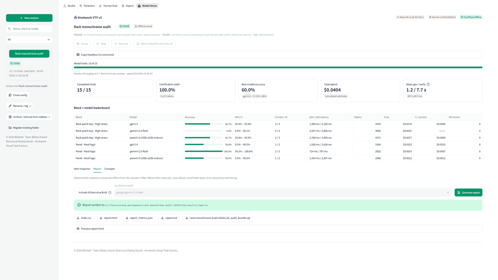
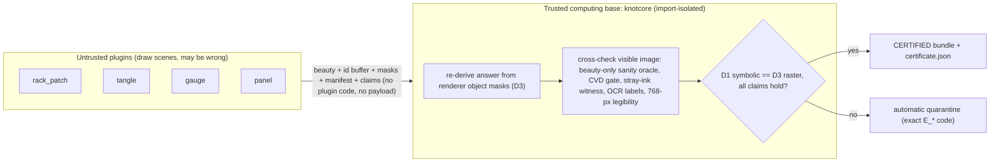
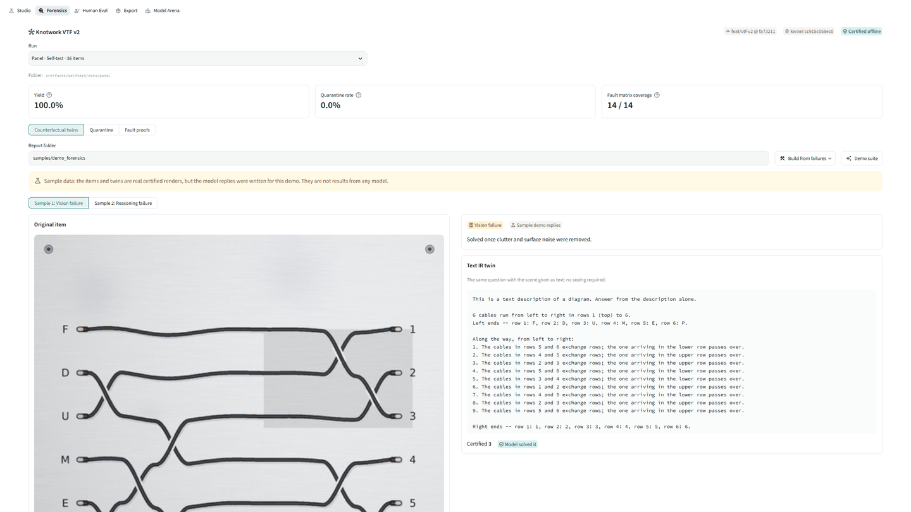

# Knotwork — Proof-Carrying Visual Task Factory

**Synthetic visual reasoning tasks for VLMs where every label ships with a machine-checked proof, so a wrong answer key cannot reach your benchmark.**

[](https://github.com/swaritbkp/vsfactory/actions/workflows/ci.yml)


Innodata AI Hackathon 2026 · Track 2 · **Visual Task Factory** · Team Bilota

| Rubric criterion | Where to look (each one is a short read) |
|---|---|
| Working & repeatable (25 %) | [3-command quickstart](#quickstart-offline-3-commands-or-docker) · [Docker](#docker) · CI on every push |
| Validity evidence (25 %) | [Zero-trust kernel](#how-knotwork-proves-every-task-zero-trust-architecture) · [proof metrics](#proof-metrics) · [`VERIFICATION.md`](VERIFICATION.md) |
| Meaningful variation (20 %) | Vendi 2.1×–3.7× over recolouring · causal / nuisance twins · structural OOD holdouts |
| Originality (15 %) | [Rack patch-bay + topological tangles + proof-carrying factory](#what-it-makes-and-what-it-found) |
| Practical impact & communication (15 %) | [Why this matters](#why-this-matters) · [5-page Studio and Model Arena](#5-page-factory-studio-and-model-arena) |

---

## Why this matters

Frontier VLMs are now being evaluated for **data-center operations, field-service copilots and brownfield
MRO**: server rack patch bays, wiring harnesses, plant control panels and legacy analog gauges. A
greenfield plant can replace analog dials with digital telemetry. **You cannot bolt an OBD port onto a
tangled 24-port Cat6 loom or a misrouted wiring harness**: someone, or some model, has to trace it by eye.
When that tracing fails you get miswired racks, missed safety interlocks and costly downtime.

The benchmarks used to judge these models have two quiet failure modes. Static test sets leak into
training data, and labels written by an LLM-as-a-judge are sometimes wrong without anyone noticing.
Knotwork addresses both. It generates fresh items on demand, and it emits an item only when an isolated
kernel has independently re-derived and certified the answer.

## What it makes, and what it found


* **Server Rack Patch-Bay** (`rack_patch`, new in v2): a 2U `SWITCH-A` / `PATCH-B` chassis with an
  8–14 cable loom. Typical question: "trace the cable from switch port SW-05; which patch port does it
  end in?"
* **Topological cable tangles** (`tangle`): cables woven from braid words, so the answer depends on
  real over/under crossings and cannot be read off position or colour.
* **Proof-carrying factory**: every bundle `(image, question, answer, evidence)` carries a kernel
  certificate. `gauge` (analog dials) and `panel` (cables from sockets into gauges) run through the same
  kernel unchanged, which shows that new domains plug in without touching the trusted code.

**Headline finding (live, human-approved run).** We tested GPT-5.4, Gemini 2.5 Flash and Qwen3-VL-235B
on `tangle`, `gauge` and `panel` items: **1,069 trials for $1.12 in total**. Overall accuracy was only
about **20–25 %**. When every cable was rendered in one colour, so colour could no longer stand in for
tracing, **GPT-5.4 fell from 59.4 % to 3.1 %** (32 matched pairs, exact McNemar *p* = 4 × 10⁻⁵). The
geometry was identical in both conditions; only the colour shortcut was removed. (`rack_patch` was added
after this run, and its offline mock sessions are shown below.)



<details>
<summary>Full live results table and caveats</summary>

One live run on the 600-item-per-plugin `split=test` pool (monochrome cables), seed 0, adaptive
staircases plus the diagnostic blocks of `SPEC.md` §12, then a 72-trial true-premise control (SPEC D-37).
943 paid calls / 1,069 trials, 0 HTTP errors: main run $0.9992 (871 calls, 997 trials), control $0.0756
(72 calls), canaries $0.0501.

| | GPT-5.4 | Gemini 2.5 Flash | Qwen3-VL-235B |
|---|---|---|---|
| Overall accuracy | 25.2 % | 20.5 % | 20.2 % |
| Tangle · panel · gauge reading | 27.3 · 22.8 · 15.6 % | 17.0 · 24.4 · 25.0 % | 21.0 · 19.4 · 6.2 % |
| Colour ablation: unique colours → monochrome (32 pairs; exact McNemar *p*) | 59.4 → 3.1 % (4 × 10⁻⁵) | 18.8 → 9.4 % (0.38) | 37.5 → 15.6 % (0.065) |
| Twins: original / causal / nuisance | 29 / 12.5 / 25 % | 25 / 12.5 / 29 % | 25 / 12.5 / 25 % |
| "Yes" on true vs false premise (of 24; McNemar *p*) | 0 vs 0 (1.00) | 15 vs 12 (0.45) | 23 vs 24 (1.00) |
| Main run cost | $0.808 | $0.121 | $0.070 |

Caveats: accuracy sits near the floor, so the staircases bound thresholds rather than measure them
(`BLOCKERS.md` L-1). Per-model twin drops are directional only (n = 24, *p* = 0.125 / 0.25 / 0.375). No
model detectably told true premises from false ones, so false-premise rates alone are not evidence that
a model checked the premise. Abstention is not measured. Raw outputs are in
[`samples/live_run/`](samples/live_run/), and `uv run knot report` rebuilds every figure offline.
</details>

## How Knotwork proves every task (zero-trust architecture)



Plugins are treated as untrusted. They hand the kernel rasters and declarative JSON, never code or their
internal scene state. The kernel **re-derives every answer from renderer object masks, cross-checked
against the visible image via a beauty-only sanity oracle, colourblindness (CVD) gate, and stray-ink
witness.** A bundle is emitted only if that raster answer (D3) equals the generator's symbolic answer
(D1) and every plugin claim re-checks. Anything else goes to quarantine with an exact error code.

The trust boundary is enforced in code, and CI checks it on every push:
`import-linter` forbids `knotcore` from importing plugins, the pipeline, the network or geometry/UI
libraries, and the TCB audit (`kernel_audit.tcb_report`, SPEC D-38) allow-lists its imports, bans
network, process and dynamic-code modules, bans `SceneIR.payload` access, and pins a deterministic
`kernel_sha256`.

### Proof metrics

| Evidence | Result | Source |
|---|---|---|
| Fault-injection matrix M1–M14 (4 injections per fault) | **56 / 56 caught** with the expected code, **0 / 56 clean controls rejected** | `knot mutate --fault all --n 4` |
| A real render defect, caught by our own kernel | panel halo clipping broke the top cable at crowded crossings (4 / 120 clean panels failed the crossing-colour check); after the renderer fix, 0 / 400 | commit `aaf2528` |
| Golden self test | **66 / 66** bundles regenerated and re-verified; file-only `knot verify` catches a 1-bit id-buffer edit | `knot selftest`, `knot verify` |
| `rack_patch` yield, unmodified kernel | **10 / 10 certified** on the 10-render gate set, 8 / 10 on the first attempt (gate ≥ 80 %) | `tests/arena/test_rack_patch.py` |
| Structural diversity (Vendi, 256 items) | **2.1×–3.7×** a recolour-only baseline (tangle 3.73×, panel 2.95×, gauge 2.13×) | `knot diversity` |
| Variation controls | causal twins (minimal edit, answer changes) vs nuisance twins (restyle, answer kept); structural OOD holdout splits (held-out families and parameter ranges) | Studio → Batch & OOD Build |

## 5-page Factory Studio and Model Arena



`uv run streamlit run apps/inspector.py`. It runs offline: the Studio sets `KNOTWORK_NETWORK=deny` at
start-up.

| Page | What it does |
|---|---|
| **Studio** | Generate and certify one task for any plugin (Tangle, Gauge, Panel, Rack patch-bay) with presets; switch between Beauty / Witness Overlay / ID Buffer / CVD Simulation views; build batches with OOD holdouts and twins. |
| **Forensics** | KPI strip (yield, quarantine rate, 14 / 14 fault coverage); counterfactual twins that separate vision failures from reasoning failures (perceptual-clean, palette-swap, step-down and text-IR twins); quarantine browser; fault proofs that open on a committed default pair (`M3 → E_LABEL_MISMATCH`, [`samples/fault_proof/`](samples/fault_proof/)). The opening twin sample uses real certified renders paired with **labelled sample demo replies, not live VLM output**. To inspect real failures, send them live from Model Arena. |
| **Human Eval** | Human calibration lab: one blind certified item at a time, scored live against the benchmarked models. |
| **Export** | Harbor task folders (oracle `solve.sh`, `tests/test.sh` → reward), HF parquet, RLVR jsonl. |
| **Model Arena** | A **Sessions Sidebar** (search, clone, compare, archive, register an external folder). Each session keeps a frozen `data_dir` separate from its `results_dir`. A multi-block campaign builder covers every plugin, `rack_patch` included, from 1 to 100,000 items. Choose **Offline Mock** mode, or opt in to the OpenRouter vision catalog: the explicit **"Refresh live catalog"** button, plus a custom API key kept for the session only. Background campaigns are crash-safe and resumable (pause / stop / retry-failed-only / spend cap). Any wrong answer can be sent to Forensics with **"Send failure to Forensics"**. Reports export as `report.html`, `report.md`, `report_metrics.json`, `trials.csv` and an audit ZIP, with 95 % Wilson CIs, z / Fisher tests and inline SVG charts. |

## Quickstart (offline, 3 commands) or Docker

```bash
uv sync --locked                              # locked env, no API keys
uv run knot selftest --seeds-only             # determinism known-answer test (seconds)
uv run streamlit run apps/inspector.py        # 5-page Studio at http://localhost:8501
```

More CLI (all offline): `knot selftest` (golden end-to-end), `knot mutate --fault all --n 4` (M1–M14
matrix), `knot generate --plugin panel --n 20 --out data/panel`, `knot verify data/panel` (file-only,
runs no plugin code), `knot export --format harbor`, `knot bench --offline --client mock`, `knot report`.
Paid benchmarking is opt-in only: it needs a human approval file plus `OPENROUTER_API_KEY` (`SPEC.md` §1).

### Docker

```bash
docker build -t knotwork .
docker run --rm knotwork uv run knot selftest --seeds-only
docker run --rm -p 8501:8501 knotwork uv run streamlit run apps/inspector.py --server.address 0.0.0.0
```

The image is Python 3.12 slim built with `uv sync --locked`. It runs as the non-root `appuser` with
`KNOTWORK_NETWORK=deny`, `UV_OFFLINE=1` and no API keys baked in.

## Repository map (v2)

| Path | What |
|---|---|
| `src/knotwork/knotcore/` | trusted kernel (TCB): contracts, seeds, topology, OCR, witness, CVD, oracle, grading |
| `src/knotwork/plugins/` | untrusted scene plugins: `rack_patch`, `tangle`, `gauge`, `panel` (+ registry) |
| `src/knotwork/render/` · `pipeline/` | renderer (2× beauty, 1× non-AA masks and id buffer) · generate / certify / verify / mutate / twins |
| `src/knotwork/arena/` | Model Arena engine: sessions storage, catalog, resumable runner, report engine, Forensics loop |
| `src/knotwork/studio/` | Studio logic: factory, fault proofs, forensics, presentation |
| `src/knotwork/export/` · `bench/` · `probes/` · `freshness/` | Harbor / HF / RLVR exporters · staircase bench · shortcut probes · beacon seeds and burn ledger |
| `apps/` | Streamlit entry `inspector.py` and the 5 pages in `app_pages/` |
| `samples/` | browsable twins, live failures, live-run outputs, demo forensics, default fault proof |
| `tests/` | offline suite, tiered: `tier0` + `tier1` in `ci.yml`, `tier2` in `nightly.yml` |
| `Dockerfile` · `.github/workflows/` | offline image · CI (`ci.yml`) and nightly (`nightly.yml`) |
| `SPEC.md` · `VERIFICATION.md` · `DATA_CARD.md` · `BLOCKERS.md` | spec and decision log · gate results · data card · open limitations |

## Honest disclosures and current limits

* **Blocker 3.6, shortcut probes (`p3.probes`):** the original tangle T1/T3 and premise-family leaks
  now pass in v2. One new row still fails: panel P1 image statistics, **0.173 vs a 0.164 limit**. The
  gate fails on that single row, and the threshold is unchanged.
* **Blocker 5.6, mock staircase (`p5.bench_mock`):** passes with a distinct item on every trial. Mock A
  panel sits exactly at the **1.5-level boundary** because the split has few panel items with 6 or more
  crossings.
* **Kernel size:** the original 850 / 1350 LOC caps are now informational telemetry (SPEC D-38). The
  boundary is enforced by the TCB contract and import isolation instead.
* **CI scope:** `ci.yml` runs `tier0` + `tier1` on every push. `tier2` (bulk generation, probes, the
  10-render `rack_patch` gate) and the phase gates run in `nightly.yml` on `main`.
* Scenes are synthetic 2-D renders. They do not support claims about natural-image perception or
  real instruments ([`DATA_CARD.md`](DATA_CARD.md)). Full details are in [`BLOCKERS.md`](BLOCKERS.md).

## Team Bilota

Built by **Swarit Sharma** and **Pankaj David** for the Innodata AI Hackathon 2026, Track 2.

© 2026 BilotaAI. Code: Apache-2.0 ([`LICENSE`](LICENSE)). Bundled font: DejaVu Sans (Bitstream Vera
license, `assets/fonts/LICENSE-DejaVu.txt`).
