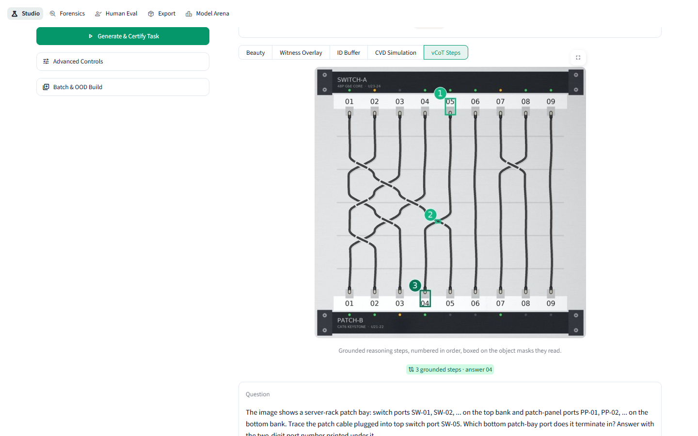
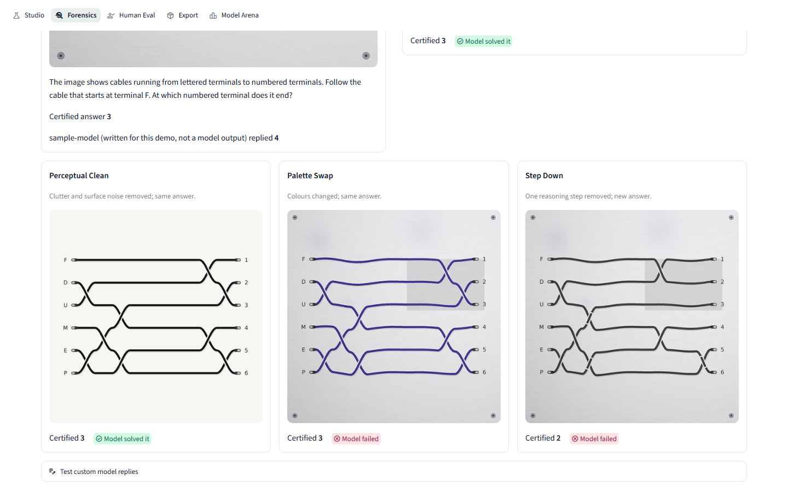
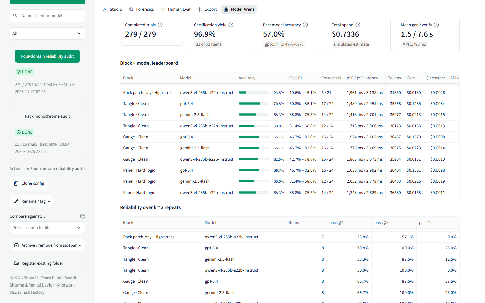
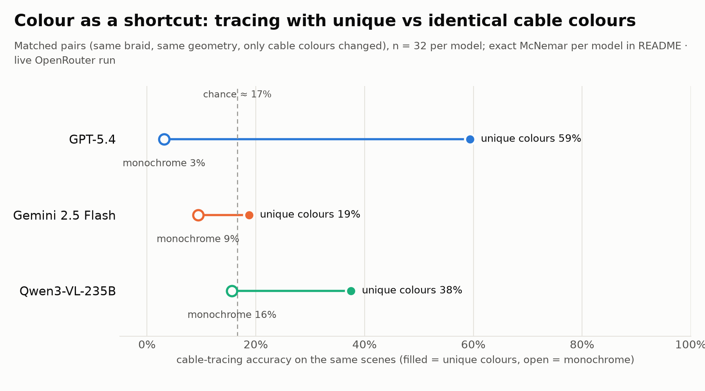
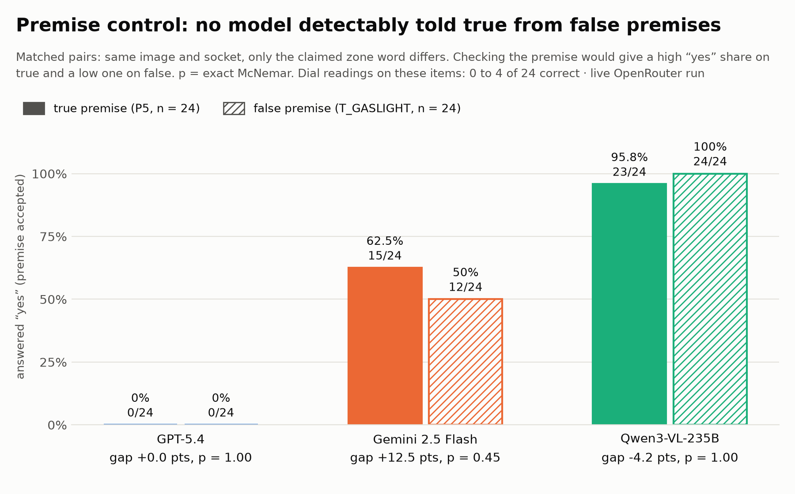
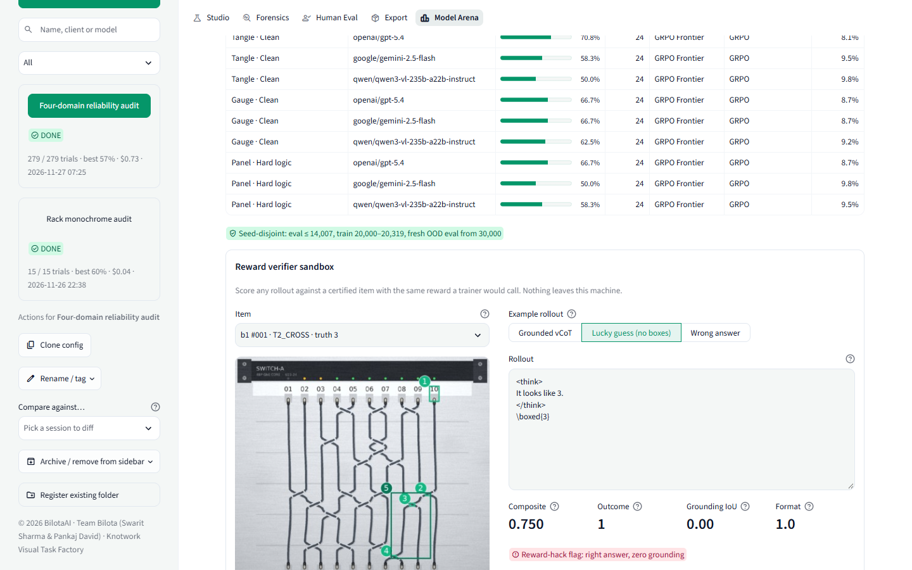
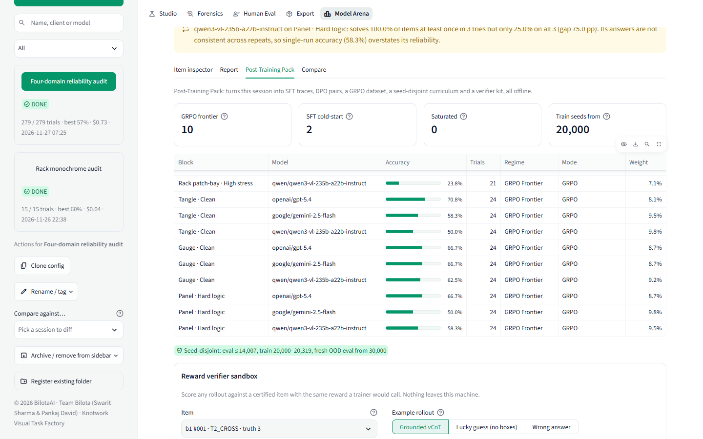

# Knotwork

**A proof-carrying visual task factory for vision-language models.**

Knotwork renders seeded industrial scenes (rack patch bays, cable tangles, analog gauges and gauge
panels) and asks questions about them. A small, import-isolated kernel re-derives every answer from
renderer object masks and cross-checks it against the visible image. A task is released only when the
generator's answer and the kernel's answer agree. The same certified tasks drive a diagnostic model
arena and a post-training pipeline: grounded chain-of-thought traces, preference pairs, GRPO data and
a reward verifier. All of it runs offline.

**Live sandbox:** [https://knotwork-demo-y5i4boaq7q-el.a.run.app/](https://knotwork-demo-y5i4boaq7q-el.a.run.app/) runs the Studio in locked Offline-Mock demo mode (`KNOTWORK_PUBLIC_DEMO=1`, `KNOTWORK_NETWORK=deny`, `max-instances=2`, GCP budget alert configured). `KNOTWORK_DEMO_ALLOW_BYOK` stays off through judging, so the public demo makes no live model calls. See
[`docs/DEPLOY_CLOUD_RUN.md`](docs/DEPLOY_CLOUD_RUN.md).

[](https://github.com/swaritbkp/vsfactory/actions/workflows/ci.yml)


| Measure | Value | Source |
|---|---|---|
| Task domains | 4: `rack_patch`, `tangle`, `gauge`, `panel` | `src/knotwork/plugins/` |
| Question families | 11 | `knotcore.contracts.Family` |
| Trusted kernel (`knotcore`) | 14 modules; 1,153 executable / 1,576 total LOC; TCB audit 0 violations | `kernel_audit.loc_report`, `tcb_report` |
| Import contracts | 3 / 3 kept (2 isolate `knotcore`, 1 keeps `tangle` and `gauge` independent) | `uv run lint-imports` |
| Fault-injection matrix | 56 / 56 injected faults caught with the expected code; 0 / 56 clean controls rejected | `knot mutate --fault all --n 4` |
| Golden self test | 66 / 66 bundles regenerate and re-verify | `knot selftest` |
| Structural diversity (Vendi) | 2.1×–3.7× a recolour-only baseline | `knot diversity` |
| Live VLM audit | 1,069 trials, 943 paid calls, $1.12 total, 3 models | `samples/live_run/` |
| v2 live 4-domain audit | 531 calls (530 scored), *k* = 3, *T* = 0.7, $0.67, 3 models; pack 55 SFT / 354 DPO / 59 GRPO | [`docs/evidence/v2_live_audit/`](docs/evidence/v2_live_audit/) |
| Certified throughput | 544–831 `rack_patch` items/hour on one vCPU; $48–$74 per 1M at $0.04/vCPU-hour | `knot bench-throughput` |
| Test suite | 563 offline tests (`tier0` 186, `tier1` 273, `tier2` 104) | `uv run pytest --collect-only` |
| Network policy | `KNOTWORK_NETWORK=deny` by default; paid calls are opt-in | `Dockerfile`, `tests/conftest.py` |


*Studio, vCoT Steps view. A certified `rack_patch` trace question (answer `04`) with its three
grounded reasoning steps. Each numbered box is the pixel extent of an object mask the step reads.*

---

## Contents

1. [The problem](#1-the-problem)
2. [Architecture and proof-carrying verification](#2-architecture-and-proof-carrying-verification)
3. [Task domains and question families](#3-task-domains-and-question-families)
4. [The Studio](#4-the-studio)
5. [Empirical evaluation and Model Arena](#5-empirical-evaluation-and-model-arena)
6. [Post-training engine](#6-post-training-engine)
7. [MLOps, release gating and extensibility](#7-mlops-release-gating-and-extensibility)
8. [Deployment and reproducibility](#8-deployment-and-reproducibility)
9. [Limitations and open items](#9-limitations-and-open-items)
10. [Failure cases](#10-failure-cases)
11. [Way forward](#11-way-forward)
12. [References, documentation map and provenance](#12-references-documentation-map-and-provenance)

---

## 1. The problem

Synthetic visual reasoning data fails in three structural ways.

**The label and the image come from the same place.** When the script that draws a scene also
writes its answer, every renderer bug becomes a wrong label: a cable clipped at a crossing, a label
hidden behind another object, a needle drawn a few degrees off. Grading with a second model only
moves the problem. Nothing in such a pipeline checks the answer against the pixels a model actually
sees.

**Models take shortcuts.** A model can score well on cable tracing by matching colours rather than
following a path. It can answer a premise question from language priors rather than from the dial.
It can also recall items from a public test set it has seen in training. Accuracy on a static set
cannot tell these apart from real perception.

**Evaluation does not feed training.** A static `(image, answer)` benchmark reports a score. It does
not say which step of the perception failed, and it produces no grounded reasoning traces or
tamper-resistant reward that a post-training run could use.

Knotwork addresses each in turn. It certifies every label against the rendered pixels with a kernel
that never sees the generator's internal state. It generates counterfactual twins that isolate
shortcuts. It turns every certified item into grounded training data and a deterministic reward.

## 2. Architecture and proof-carrying verification

```
  Domain plugin (untrusted)                     knotcore (trusted computing base)
  rack_patch | tangle | gauge | panel           import-isolated, rasters + JSON only
 +-----------------------------------+        +------------------------------------------+
 | sample seeded SceneIR             |        | D3: re-derive the answer from object     |
 | render:                           |        |     masks (geodesic TRACE, CROSS, ONTOP, |
 |   beauty RGB (2x, Lanczos to 1024)| -----> |     READ, ZONE, GAUGE_OF, ...)           |
 |   amodal masks (1x, no AA)        | files  | cross-check the visible image:           |
 |   modal 16-bit id buffer          | only   |   beauty-only sanity oracle, CVD gate,   |
 |   manifest + claims + question    |        |   stray-ink witness, OCR labels,         |
 | D1: symbolic answer               |        |   768-px legibility                      |
 +-----------------------------------+        | D1 == D3 and every claim re-checks?      |
                                              +-------------------+----------------------+
                                                   yes            |            no
                                         +-------------------------+------------------------+
                                         v                                                  v
                     CERTIFIED bundle + certificate.json                 QUARANTINE with an exact E_* code
```

A plugin samples a scene from a seed, renders it and states its own answer (D1). It hands the kernel
files only: the beauty image, the amodal object masks, the modal id buffer, a render manifest,
declarative claims and the question program. The kernel never imports plugin code and never reads the
plugin's scene payload. It **re-derives every answer from renderer object masks, cross-checked against
the visible image** (D3). Five checks tie that answer to the visible image:

- a **beauty-only sanity oracle** re-reads the answer from the RGB image alone;
- a **colour-vision-deficiency (CVD) gate** checks that colours which carry meaning stay
  distinguishable under simulated protanopia and deuteranopia;
- a **stray-ink witness** checks that every inked pixel is explained by a declared object;
- **OCR** cross-checks every declared label against the pixels;
- a **legibility** check measures strokes, crossing angles and labels at the 768-px resolution a
  model receives.

A bundle is certified only when D1 equals D3 and every claim re-checks. Anything else is quarantined
with an exact error code. The certificate records every step's evidence and the kernel's SHA-256.

### The trusted computing base

`src/knotwork/knotcore/` has 14 modules: contracts, seeds, io, topo, gauge, logic, OCR, witness, CVD,
legibility, oracle, engine and grading (plus `__init__`). Its executable code is 1,153 lines (1,576
including the declarative `contracts.py`). The original 850 / 1,350-line budgets are reported as
telemetry since SPEC D-38. The boundary is enforced by two mechanisms instead:

- `import-linter` forbids `knotcore` from importing any other Knotwork package (plugins, pipeline,
  export, bench, CLI) and any network, UI, ML or scene-geometry library (`httpx`, `requests`,
  `shapely`, `streamlit`, `sklearn`, `pandas`, ...). A third contract keeps `tangle` and `gauge`
  independent, so only `panel` composes them.
- The TCB audit (`kernel_audit.tcb_report`) allow-lists every kernel import. It bans network, process
  and dynamic-code modules, bans any access to `SceneIR.payload`, and pins a deterministic
  `kernel_sha256` (`cc915c558ec0…` on `main`).

A certificate means the following. The answer stored with the bundle was recomputed from the
rendered masks by code that cannot see how the scene was made. It matches the generator's symbolic
answer, and every declared label, object and stroke was found in the pixels. The check proves label
validity. It does not prove that a task is easy or hard.

### Fault proofs and goldens

This is **fault-injection testing**, not an external mutation-testing framework: the team designed all
14 fault classes (56 injections) itself, as adversarial corruptions of geometry, witnesses and renders,
to test whether `knotcore` detects and quarantines them. `knot mutate` injects 14 classes of renderer bug (M1–M14: swapped labels, clipped halos, shifted
needles, missing crossings, wrong zone colours, panel composition faults and others), 4 injections
each. The kernel catches all 56 with the expected error code and rejects none of the 56 clean
controls. The kernel also caught a real defect during development. At crowded panel crossings the
renderer clipped the top cable's halo, and 4 of 120 clean panels failed the crossing-colour check.
After the renderer fix, 0 of 400 failed (commit `aaf2528`).

`knot selftest` regenerates 66 golden bundles from seed 1234 (18 `tangle`, 12 `gauge`, 36 `panel`:
2 base items per family plus their twins). It checks answers, verdicts, mask and id-buffer digests,
and the kernel hash. `knot verify` re-verifies a bundle or dataset from files alone and executes no
plugin code. A single-bit change to an id buffer is reported as `E_DIGEST_MISMATCH`.

## 3. Task domains and question families

| Domain | Scene | Families |
|---|---|---|
| `rack_patch` | A 2U `SWITCH-A` bank above a `PATCH-B` bank, joined by a loom of 8–14 patch cables. Half the scenes use one cable colour. | T1, T2 |
| `tangle` | Cables woven from braid words, so the path depends on real over/under crossings. Strip and horseshoe layouts. | T1, T2, T3 |
| `gauge` | Analog dials with varied bezels, faces, tints, surface grime and a glass glare crescent. Linear scales, green / amber / red zones. | G1, G2 |
| `panel` | Lettered sockets cabled through a tangle to labelled gauges. Questions compose tracing with dial reading. | P1–P5, T_GASLIGHT |

| Family | Question |
|---|---|
| `T1_TRACE` | Follow the cable from a start terminal; where does it end? |
| `T2_CROSS` | How many crossings does a cable pass through? |
| `T3_ONTOP` | At the *k*-th crossing of two named cables, which one lies on top? |
| `G1_READ` | What value does the gauge read? (graded within ±2 % of scale) |
| `G2_ZONE` | Which coloured zone is the needle in? |
| `P1_READ_TRACE` | Trace a socket's cable to its gauge, then read the gauge. |
| `P2_ZONE_TRACE` | Trace a socket's cable to its gauge, then name the zone. |
| `P3_ARGMAX_PORT` | Which socket feeds the gauge with the highest reading? |
| `P4_COUNT_ZONE` | How many gauges sit in a given zone? |
| `P5_PREMISE_CONTROL` | A true premise about a traced gauge's zone: confirm it and read the value. |
| `T_GASLIGHT` | The matched false premise: reject it and read the value. |

**Seeds and splits.** All randomness flows through `knotcore.seeds.SeedTree` along canonical paths,
and generation can be seeded from a public beacon (drand, NIST) or an offline counter. Bundles are
content-addressed by SHA-256. Splits are `dev`, `test`, `sealed` and `ood`. The `ood` split holds out
whole families (`--holdout-family`) or parameter ranges (`--holdout-param strands=9:10`).

**Twins.** Every base item can carry a *causal twin* and a *nuisance twin*. The causal twin is a
minimal edit (under 5 % of pixels) that changes the answer. The nuisance twin is a restyle (at least
2 % of pixels) that keeps it. For a failed item, `knot counterfactual` builds four certified
diagnostic twins:

| Twin | Change | Reading |
|---|---|---|
| Perceptual Clean | Clutter, noise, jitter and surface realism removed | Solving it after failing the original points at perception under clutter |
| Palette Swap | Same scene under a rotated, colour-vision-safe palette | Separates colour shortcuts from tracing |
| Step Down | One crossing fewer on the queried path | Solving only this points at reasoning depth |
| Text IR | The scene given as structured text | Solving this but no image points at the vision encoder |


*Forensics, counterfactual twins. One certified tangle item beside its Perceptual Clean, Palette
Swap and Step Down twins, each re-certified by the kernel. The model replies on this committed sample
page were written for the demonstration and are labelled as such. Real replies come from Model Arena.*

## 4. The Studio

```bash
uv run streamlit run apps/inspector.py      # http://localhost:8501, sets KNOTWORK_NETWORK=deny at start-up
```

| Page | Purpose |
|---|---|
| **Studio** | Generate and certify one task for any domain with a preset (Clean, Hard logic, High stress, CVD) or advanced controls. Five views: Beauty, Witness Overlay, ID Buffer, CVD Simulation, vCoT Steps. Also shows the grounded SFT trace and the raw `certificate.json` / `task.json`. Batch builds with twins and OOD holdouts. |
| **Forensics** | Yield, quarantine rate and fault-matrix coverage (14 / 14). Counterfactual twin suites that separate vision failures from reasoning failures, a quarantine browser, and fault proofs. The default proof is the committed `M3 → E_LABEL_MISMATCH` pair in [`samples/fault_proof/`](samples/fault_proof/). |
| **Human Eval** | One blind certified item at a time, scored against the benchmarked models, with Approve / Flag review. |
| **Export** | Harbor task folders, Hugging Face parquet and RLVR JSONL, optionally restricted to approved items. |
| **Model Arena** | Multi-block, resumable evaluation campaigns with reports and a Post-Training Pack tab (sections 5 and 6). |

Guided mode puts a step strip (step *n* of 5, with a next-step button) on every page. It also adds a
page-guide popover, a 5-step Quick Tour and 178 hover tooltips. The glossary has 10 terms, each tied
to a kernel concept: TCB, D1 = D3, beauty-only oracle, CVD gate, stray-ink witness, quarantine codes,
causal vs nuisance twins, OOD holdout, Wilson interval and cost per correct answer.

## 5. Empirical evaluation and Model Arena

### Model Arena

A session has a frozen dataset folder (`data_dir`) kept separate from its results folder
(`results_dir`). A campaign is a list of blocks, each a domain, preset, item count and seed, run
against one or more models. Runs execute in the background, and every trial is appended to
`results.jsonl` under a `(block, item, model, repeat)` key. A crash or a pause therefore resumes
without repeating any trial. Controls cover pause, stop, retry-failed-only and a hard spend cap.

- **Modes.** *Offline Mock* simulates model replies with no network. *Live* calls OpenRouter only
  after an explicit opt-in, with a key from the environment or pasted for one browser session.
- **Repeats and temperature.** With *k* = 1–5 repeats per item, the report gives `pass@1`, `pass@k`
  (solved at least once) and `pass^k` (solved on every repeat). It adds a finding whenever
  `pass@k − pass^k` is 10 points or more. The temperature control (0.0–1.0, default 0) makes repeats
  stochastic.
- **Statistics.** Wilson 95 % intervals on every accuracy, z-tests and Fisher exact tests across
  blocks, an error taxonomy, latency percentiles and cost per correct answer.
- **Outputs.** `report.html`, `report.md`, `report_metrics.json`, `trials.csv` and an audit ZIP.
  Any wrong answer can be sent to Forensics or pinned to a regression suite.


*Model Arena, the live `full_v2_live_eval` session (530 / 531 trials scored, k = 3, temperature
0.7, $0.67). The leaderboard shows Wilson intervals and cost per correct answer, and the
reliability table shows `pass@1`, `pass@k` and `pass^k` per block and model.*

### v2 Full 4-Domain Live Reliability & Post-Training Audit (531 Live Calls, `k = 3`, `T = 0.7`)

Run on 2026-11-27 from the committed campaign file
[`docs/examples/full_v2_live_campaign.yaml`](docs/examples/full_v2_live_campaign.yaml) (hard spend cap
$10.00). It has 5 blocks of 12 freshly generated items, 3 models, *k* = 3 repeats per item at
temperature 0.7. The plan was 5 × 12 × 3 × 3 = 540 calls. The kernel certified 59 of the
60 items and quarantined 1 (`rack_patch` monochrome), and only certified
items are asked, so **531 live calls** went out: 530 scored and 1 API error
(Gemini 2.5 Flash, `rack_patch` monochrome; not retried). **Spend: $0.6727.** Kernel
`cc915c558ec0`.

| Model | Scored trials | Accuracy (Wilson 95 % CI) | API errors | Cost |
|---|---|---|---|---|
| GPT-5.4 | 177 | 44.6 % (37.5–52.0) | 0 | $0.5295 |
| Gemini 2.5 Flash | 176 | 28.4 % (22.3–35.5) | 1 | $0.0732 |
| Qwen3-VL-235B-A22B | 177 | 26.6 % (20.6–33.5) | 0 | $0.0700 |

GPT-5.4 leads clearly. Gemini 2.5 Flash and Qwen3-VL-235B-A22B are a **statistical tie**: their
Wilson 95 % intervals overlap almost entirely.

Per block, `pass@1` is single-attempt accuracy over all repeats, `pass@3` the share of items solved at
least once in 3 tries and `pass^3` the share solved on all 3. Gap = `pass@3 − pass^3`.

| Block | Model | Items | pass@1 (Wilson 95 % CI) | pass@3 | pass^3 | Gap | Cost |
|---|---|---|---|---|---|---|---|
| `rack_patch` · standard colour (Clean) | GPT-5.4 | 12 | 61.1 % (22/36; 44.9–75.2) | 75.0 % | 50.0 % | 25.0 pp | $0.1144 |
| `rack_patch` · standard colour (Clean) | Gemini 2.5 Flash | 12 | 13.9 % (5/36; 6.1–28.7) | 25.0 % | 0.0 % | 25.0 pp | $0.0173 |
| `rack_patch` · standard colour (Clean) | Qwen3-VL-235B-A22B | 12 | 19.4 % (7/36; 9.8–35.0) | 25.0 % | 16.7 % | 8.3 pp | $0.0189 |
| `rack_patch` · monochrome (High stress) | GPT-5.4 | 11 | 27.3 % (9/33; 15.1–44.2) | 45.5 % | 9.1 % | 36.4 pp | $0.1044 |
| `rack_patch` · monochrome (High stress) | Gemini 2.5 Flash | 10 (+1 partial) | 12.5 % (4/32; 5.0–28.1) | 30.0 % | 0.0 % | 30.0 pp | $0.0151 |
| `rack_patch` · monochrome (High stress) | Qwen3-VL-235B-A22B | 11 | 3.0 % (1/33; 0.5–15.3) | 9.1 % | 0.0 % | 9.1 pp | $0.0212 |
| `tangle` · monochrome (High stress) | GPT-5.4 | 12 | 47.2 % (17/36; 32.0–63.0) | 83.3 % | 16.7 % | 66.7 pp | $0.1164 |
| `tangle` · monochrome (High stress) | Gemini 2.5 Flash | 12 | 33.3 % (12/36; 20.2–49.7) | 58.3 % | 8.3 % | 50.0 pp | $0.0192 |
| `tangle` · monochrome (High stress) | Qwen3-VL-235B-A22B | 12 | 30.6 % (11/36; 18.0–46.9) | 50.0 % | 8.3 % | 41.7 pp | $0.0158 |
| `gauge` · aged dial (High stress) | GPT-5.4 | 12 | 75.0 % (27/36; 58.9–86.2) | 91.7 % | 58.3 % | 33.3 pp | $0.0887 |
| `gauge` · aged dial (High stress) | Gemini 2.5 Flash | 12 | 63.9 % (23/36; 47.6–77.5) | 75.0 % | 50.0 % | 25.0 pp | $0.0099 |
| `gauge` · aged dial (High stress) | Qwen3-VL-235B-A22B | 12 | 63.9 % (23/36; 47.6–77.5) | 75.0 % | 58.3 % | 16.7 pp | $0.0060 |
| `panel` · sockets-to-gauges (Hard logic) | GPT-5.4 | 12 | 11.1 % (4/36; 4.4–25.3) | 16.7 % | 8.3 % | 8.3 pp | $0.1056 |
| `panel` · sockets-to-gauges (Hard logic) | Gemini 2.5 Flash | 12 | 16.7 % (6/36; 7.9–31.9) | 33.3 % | 8.3 % | 25.0 pp | $0.0117 |
| `panel` · sockets-to-gauges (Hard logic) | Qwen3-VL-235B-A22B | 12 | 13.9 % (5/36; 6.1–28.7) | 16.7 % | 8.3 % | 8.3 pp | $0.0082 |

Three findings follow.

1. **The combined monochrome + high-stress preset breaks `rack_patch` tracing for GPT-5.4.** Under
   the High stress preset (monochrome cables, visual stress 0.8, realism 0.9), GPT-5.4 dropped
   sharply from 61.1 % to 27.3 % across 3-repeat trials (7/12 vs. 3/11 by per-item majority, Fisher
   *p* ≈ 0.21; the repeat-pooled *p* = 0.007 treats 3 repeats per image as independent observations,
   though they are dependent). This reflects the combined stress preset, not an isolated colour-only
   ablation; the clean colour-only ablation is the v1 `tangle` result below (59.4 % → 3.1 %).
   Qwen3-VL went 19.4 % → 3.0 % (repeat-pooled Fisher *p* = 0.057) and Gemini 2.5 Flash
   13.9 % → 12.5 % (*p* = 1.000), already near the floor on the Clean block.
2. **Single-run accuracy overstates reliability.** 11 of 15 block × model cells have a
   `pass@3 − pass^3` gap of 10 points or more. The widest: GPT-5.4 on
   `tangle` monochrome solves 83.3 % of items at least once but only
   16.7 % on all three tries.
3. **Multi-hop panels are the floor; aged gauges are the ceiling.** `panel` Hard logic sits at
   11.1–16.7 % for every model, while the aged `gauge` dial reaches 63.9–75.0 %.

**Post-training pack** (`knot posttrain-pack` on this session, offline): 8 GRPO Frontier cells,
7 SFT Cold-Start cells, 0 Saturated; **55 SFT** grounded-vCoT records, **354 DPO**
preference pairs and **59 GRPO** prompts (0 skipped). Training seeds are disjoint from evaluation
seeds (eval ≤ 2,626, train 10,000–10,599, fresh OOD eval from 20,000).

Audit files: [`report.md`](docs/evidence/v2_live_audit/report.md),
[`report_metrics.json`](docs/evidence/v2_live_audit/report_metrics.json) (every metric, Wilson
interval, z / Fisher contrast and finding), [`trials_summary.csv`](docs/evidence/v2_live_audit/trials_summary.csv)
(all 531 trials without raw replies, checked for secrets),
[`posttrain_summary.json`](docs/evidence/v2_live_audit/posttrain_summary.json) (frontier table, pack
counts, provenance attestation) and [`verification_log.txt`](docs/evidence/v2_live_audit/verification_log.txt).
Raw images and the full workspace stay local in `artifacts/arena_workspaces/full_v2_live_eval/`.

### v1 Phase 5 live audit and P5 control audit (1,069 trials, $1.12)

One live run on the 600-item-per-plugin `split=test` pool: `tangle`, `gauge` and `panel`, monochrome
cables, seed 0. It combined adaptive staircases with diagnostic blocks (colour ablation, twins,
composition, false premise), followed by a 72-call true-premise control.

| Run | Paid calls | Trials | Cost |
|---|---|---|---|
| Canaries | not counted | 0 | $0.0501 |
| Main run | 871 | 997 | $0.9992 |
| True-premise control (SPEC D-37) | 72 | 72 | $0.0756 |
| **Total** | **943** | **1,069** | **$1.12** |

0 HTTP errors, 2 unparsable replies. An offline replay of the cached responses reproduces every
per-model statistic of the main run with 0 network calls.

| | GPT-5.4 | Gemini 2.5 Flash | Qwen3-VL-235B-A22B |
|---|---|---|---|
| Overall accuracy | 25.2 % | 20.5 % | 20.2 % |
| Tangle · panel · gauge reading | 27.3 · 22.8 · 15.6 % | 17.0 · 24.4 · 25.0 % | 21.0 · 19.4 · 6.2 % |
| Tracing, unique colours → monochrome (32 matched pairs; exact McNemar *p*) | 59.4 → 3.1 % (4 × 10⁻⁵) | 18.8 → 9.4 % (0.38) | 37.5 → 15.6 % (0.065) |
| Twins: original / causal / nuisance (n = 24) | 29 / 12.5 / 25 % | 25 / 12.5 / 29 % | 25 / 12.5 / 25 % |
| "Yes" to a true vs a false premise (24 pairs; exact McNemar *p*) | 0 % vs 0 % (1.00) | 62.5 % vs 50.0 % (0.45) | 95.8 % vs 100 % (1.00) |
| Main-run cost | $0.808 | $0.121 | $0.070 |



Three findings follow.

1. **Colour stood in for tracing.** On matched pairs with identical geometry, only the cable colours
   changed. GPT-5.4 traced 59.4 % of unique-colour cables and 3.1 % of monochrome ones, below the
   17 % chance rate.
2. **No model checked the premise.** Each true-premise control differs from its false-premise item
   only in the claimed zone word, and both are certified on identical pixels. A model that read the
   dial would say "yes" far more often to the true premise. None did. GPT-5.4 rejected every premise,
   true or false. Qwen3-VL accepted nearly every one. Gemini's 12.5-point gap is not significant. A
   false-premise rejection rate on its own is therefore not evidence of grounding.
3. **Overall accuracy sits near the floor.** The staircases bound rather than measure thresholds
   (`BLOCKERS.md` L-1), and per-model twin drops are directional at n = 24.



`rack_patch` was added after this run; its live results are in the v2 audit above. Raw outputs, per-trial
records and the control's certification checks are in [`samples/live_run/`](samples/live_run/).
`uv run knot report` rebuilds every figure offline.

## 6. Post-training engine

`src/knotwork/posttrain/` turns certified items and Arena sessions into training data and a reward.
It calls the kernel's grader and topology primitives but changes nothing in `knotcore`.

### Grounded visual chain-of-thought (`vcot.py`)

Each certified bundle yields a step-by-step trace built only from files the bundle carries: the
manifest, the amodal masks, the id buffer and the certificate's step evidence. Terminal and label boxes
come from the manifest. Crossings come from the kernel's geodesic-ordered mask overlaps
(`knotcore.topo.crossings`), and over/under from the id-buffer owner of each crossing core. Dial,
scale labels and needle come from the gauge masks and the READ witness. The SFT target is:

```
<think>Step 1 (perception): Locate the cable that starts at terminal 10. <box>[762, 114, 803, 178]</box>
Step 2 (transition): Crossing 1: the cable passes over strand s7. <box>[746, 534, 770, 549]</box>
...
Step 5 (conclusion): Counting every crossing along the cable gives 3. Final answer: 3. <box>[611, 534, 770, 796]</box></think>
\boxed{3}
```

Boxes use a 0–1000 grid, and every box is the pixel extent of a real object. No model writes the
trace, and the final answer is the certified one. In a check for this document, vCoT extraction ran
on 400 freshly certified bundles covering all 11 families and all 4 domains. It failed on none, and
the slowest item took 0.163 s.

### Anti-reward-hacking reward (`reward.py`) and verifier server

```python
knotwork.posttrain.reward.compute_score(data_source, solution_str, ground_truth, extra_info=None) -> dict
```

This is the native `verl` custom-reward signature. The module is standard-library only apart from
the kernel's own stdlib-only grader. The pack exporter ships both files verbatim, so a trainer needs
no Knotwork install. The score is a weighted sum of three terms.

| Term | Weight | Definition |
|---|---|---|
| Outcome | 0.60 | `knotcore.grading.grade_prediction` on the `\boxed{}` content. Two different committed answers score 0. |
| Grounding | 0.25 | Mean IoU of a one-to-one greedy matching between predicted `<box>` regions and the certified vCoT boxes, divided by max(#predicted, #certified) |
| Format and abstention | 0.15 | Well-formed `<think>` / `\boxed{}`, plus calibrated abstention. Accepting a false premise scores 0 abstention. |

Three rules close the obvious exploits:

- Spraying many boxes cannot buy IoU, and a full-image box (≥ 85 % of the 1000 × 1000 canvas) is
  never matched.
- A wrong answer earns only a fraction of the process credit, so it always scores below 0.25.
- A correct answer with no matched box (outcome credit needs `matched_boxes >= 1` at IoU ≥ 0.5),
  on an item that has certified boxes, raises `reward_hack_flag` and is gated: its outcome credit
  is withheld (`effective_outcome_score` 0.0, with the raw correctness still reported as
  `outcome_score`). Weak grounding earns nothing either: it gets only the format and abstention
  term, so it scores at most 0.15 and cannot gain positive GRPO advantage over grounded rollouts. Items without certified boxes are graded on outcome and format only, with the weights
  renormalised to 0.80 / 0.20, and are not gated.


*Post-Training Pack, reward verifier sandbox. A "lucky guess" rollout gets the right answer with
no boxes. The grounding gate withholds its outcome credit, so it scores 0.150 and raises the
reward-hack flag. The grounded vCoT rollout for the same item scores 1.000.*

`knot serve-verifier` exposes the same function over HTTP. It binds to loopback only, makes no
outbound calls and keeps no state:

```bash
uv run knot serve-verifier --host 127.0.0.1 --port 8090
curl -s localhost:8090/health
curl -s -X POST localhost:8090/score -d '{"solution_str": "<think>...</think>\\boxed{07}", "ground_truth": "07"}'
```

Endpoints are `GET /health`, `GET /llms.txt`, `POST /score` and `POST /score_batch` (`{"items": [...]}`).

### Adaptive curriculum and the Post-Training Pack (`curriculum.py`)

With a binary verifiable reward, a GRPO group at success rate *p* carries gradient signal in
proportion to *p*(1 − *p*). The pack exporter therefore sorts every (block, model) cell of a session
into three regimes:

| Regime | Accuracy | Treatment |
|---|---|---|
| Saturated | > 75 % | Little advantage left: down-weighted |
| GRPO Frontier | 20–75 % | Peak signal: prioritised for GRPO, weighted by *p*(1 − *p*) |
| SFT Cold-Start | < 20 % | Vanishing advantage: grounded-vCoT SFT first |

Training seeds start strictly above every evaluated seed, and a fresh OOD evaluation range starts
above those. The attestation records this as `train_seed_disjoint`. `knot posttrain-generate --spec
curriculum_spec.json --split train` renders the training items.

`knot posttrain-pack --results-dir <session>/results` (or the Arena tab) writes
`<results>/posttrain_pack/` and a deterministic `posttrain_pack.zip`:

| File | Content |
|---|---|
| `sft_grounded_vcot.jsonl` | Grounded vCoT SFT records for every item a model failed and every item in a cold-start block |
| `dpo_preferences.jsonl` | Preference pairs: a real failed reply as rejected; as chosen, another model's correct reply when one exists, otherwise the certified grounded trace |
| `grpo_rlvr_verl.parquet` / `.jsonl` | GRPO prompts with ground truth and reference boxes for `verl` |
| `curriculum_spec.json` | Regimes, weights, train and OOD seed ranges per block |
| `rlvr_kit/` | `knotwork_verl_reward.py` (self-contained), `run_verl_grpo.sh` (wired through `reward.custom_reward_function.path` / `.name`), `run_trl_grpo.py` |
| `provenance_attestation.json` | Git commit, `kernel_sha256`, dataset and eval-seed hashes, `train_seed_disjoint`, QA filter, and the one external asset: `assets/fonts/DejaVuSans.ttf`, SHA-256 `ae7b7855…837280`, Bitstream Vera / DejaVu license |


*Post-Training Pack tab for the live `full_v2_live_eval` session: 8 GRPO Frontier cells, 7 SFT
Cold-Start cells, 0 Saturated; training seeds 10,000–10,599 and a fresh OOD range from 20,000. The
exported pack holds 55 SFT, 354 DPO and 59 GRPO records.*

### Throughput and unit economics (`throughput.py`)

`knot bench-throughput` times generation, verification and vCoT extraction for every attempted item
and charges quarantined items' time to the certified ones. It prints the cost model in full:

```
usd_per_1M_certified = 1e6 * (sum(gen_ms + verify_ms + vcot_ms) / 1000 / certified) / 3600 * vcpu_usd_per_hour
```

| Run (`--domain rack_patch`, one laptop core, $0.04/vCPU-hour) | Certified | Items/hour | $ per 1M certified |
|---|---|---|---|
| `--n 4` (recorded at merge) | 4 / 4 | ~544 | ~$74 |
| `--n 8` (re-measured for this document) | 8 / 8 | 831 | $48 |

Verification dominates the cost: about 3.5 s of the 4.3 s per item in the `--n 8` run. Generation
parallelises across processes, so N cores divide wall time by roughly N at the same cost per item.
Arena reports carry the same table, built from each session's observed timings.

## 7. MLOps, release gating and extensibility

**Regression pinning and `knot gate`.** In the Arena item inspector, *Pin to Regression* adds a
failed item to `<results>/regression_suite.yaml` (seed, preset, family, certified answer). The suite
is deduplicated by domain, seed and family.

```bash
uv run knot gate --suite regression_suite.yaml --model openai/gpt-5.4 --mode mock --json-out gate.json
```

Exit codes: `0` when accuracy ≥ `min_accuracy` (default 0.85), `1` below it, `2` for a missing,
invalid or empty suite. `--mode live` re-renders each case from its seed, confirms it still
certifies to the pinned answer, and only then queries the model.

**Declarative campaigns.** A session exports to `campaign.yaml` and imports back into the builder.
The schema has no key field, and both the loader and the exporter refuse secret-shaped values.

```bash
uv run knot arena-run --campaign campaign.yaml --report    # resumable; writes report.html / .md / _metrics.json
```

**Human QA.** Human Eval and the Arena inspector show an Unreviewed / Approved / Flagged state with
Approve and Flag buttons and an optional note. Each decision is appended to `review_log.jsonl`, and
the latest decision per item wins. *Approved items only* in Export, or `knot posttrain-pack
--approved-only`, keeps approved items and records `qa_filter: approved_only` and `approved_count`
in the manifest or attestation. The filter is off by default.

**Plugins and agent-facing docs.** A plugin is untrusted by construction, so it can ship as a
separate wheel registered in the `knotwork.plugins` entry-point group
([`docs/PLUGIN_SDK.md`](docs/PLUGIN_SDK.md)). `knot plugins --json` lists built-in and external
plugins with source, version and status. It rejects import failures, missing protocol members and
name collisions with a reason. `knot new-plugin` scaffolds an in-repo plugin with its conformance
tests and adds no lines to `knotcore`. [`llms.txt`](llms.txt), also served at `GET /llms.txt`, is a
machine-readable summary. [`AGENTS.md`](AGENTS.md) is the guide for coding agents.

## 8. Deployment and reproducibility

### Quickstart

```bash
uv sync --locked                              # locked environment, no API keys
uv run knot selftest --seeds-only             # determinism known-answer test (seconds)
uv run knot selftest                          # golden end-to-end: 66 bundles regenerated and re-verified
uv run streamlit run apps/inspector.py        # the Studio at http://localhost:8501
```

A typical offline pipeline:

```bash
uv run knot generate --plugin panel --n 20 --out data/panel --twins
uv run knot verify data/panel                                   # file-only, runs no plugin code
uv run knot export --format harbor --data data/panel --out export/harbor
uv run knot bench --data data/panel --out bench/mock --offline --client mock
```

### CLI reference

All 19 subcommands are registered in the CLI conformance test (`tests/conformance/test_cli.py`).
None needs a network connection except where noted.

| Command | Purpose |
|---|---|
| `knot generate` | Generate certified bundles for `tangle`, `gauge` or `panel` (`--split`, `--twins`, `--holdout-family`, `--holdout-param`, difficulty knobs, `--workers`). `rack_patch` is generated through the Studio, Arena campaigns and `bench-throughput`. |
| `knot verify PATH` | File-only re-verification of a bundle or dataset |
| `knot selftest` | Golden end-to-end test; `--seeds-only` runs the seed known-answer vector |
| `knot mutate` | Fault-injection matrix (`--fault M1..M14\|all --n 4`) |
| `knot counterfactual` | Certified diagnostic twin suites for failed items |
| `knot diversity` | Vendi score against a recolour-only baseline |
| `knot probe` | Shortcut probes (position, colour, GBDT image statistics, text-only), answer balance, near-duplicates |
| `knot export` | Harbor, Hugging Face parquet, RLVR JSONL, manifest (`--format harbor\|hf\|rlvr\|manifest\|all`) |
| `knot bench` | Adaptive staircase and diagnostic harness (`--offline` with replay or mock clients; `--live` is gated by a human approval file and spends money) |
| `knot report` | Self-contained `report.html` and figures from `artifacts/` |
| `knot telemetry` | One run's factory telemetry, or `--compare` two runs (exit 1 on regression) |
| `knot new-plugin NAME` | Scaffold a plugin package with conformance tests |
| `knot plugins` | Built-in and external plugins with status (`--json`) |
| `knot arena-run` | Run or resume a `campaign.yaml` headlessly (`--report`) |
| `knot gate` | Regression-suite quality gate (`--mode mock\|live`, exit 0 / 1 / 2) |
| `knot serve-verifier` | Loopback RLVR verifier server |
| `knot posttrain-pack` | SFT / DPO / GRPO pack, curriculum, RLVR kit, provenance (`--approved-only`) |
| `knot posttrain-generate` | Seed-disjoint training or fresh OOD items from a curriculum spec |
| `knot bench-throughput` | Measured ms per item and $ per 1M certified samples |

### Docker (air-gapped by default)

```bash
docker build -t knotwork:v2 .
docker run --rm knotwork:v2 uv run knot selftest --seeds-only    # kernel known-answer test, then exit
docker run --rm -p 8501:8501 knotwork:v2                         # the Studio at http://localhost:8501
```

The image is `python:3.12-slim`, built with `uv sync --locked`. It runs as the non-root `appuser`
with `KNOTWORK_NETWORK=deny`, `UV_OFFLINE=1` and no API keys. It is unrestricted and reads any
folder you mount. The only outbound path is an explicit opt-in in Model Arena, which reaches
OpenRouter with a key supplied at run time.

### Sandboxed Cloud Run deployment

With `KNOTWORK_PUBLIC_DEMO=1` the same image becomes a public sandbox
([`docs/DEPLOY_CLOUD_RUN.md`](docs/DEPLOY_CLOUD_RUN.md)):

- All storage is confined to `/tmp/knotwork_demo/`. Symlinks and `..` are resolved first, and any
  path outside is refused.
- The server enforces caps: 10 items per block, 3 blocks, *k* ≤ 3 and 10-item Studio batches.
- Model Arena runs Offline Mock only. The Live mode and every API key field are removed from the
  page, and the launch handler forces `mode="mock"` with no key. The server never reads
  `OPENROUTER_API_KEY` or `.env`.
- The `Import campaign.yaml` uploader is hidden, and external `knotwork.plugins` entry points are
  not loaded: only the four built-in plugins run.
- Each browser session gets its own sandbox folder (`s_<8hex>`) under that root, with bounded
  pruning of old sessions.
- `KNOTWORK_DEMO_ALLOW_BYOK=1` would opt into a capped Small Live BYOK Test (SPEC D-50). The
  deployed demo keeps it **off through judging**: strict Offline Mock only.
- A sandbox banner shows on every page. With the variable unset or `0`, nothing changes.

```bash
docker run --rm -p 8080:8080 -e PORT=8080 -e KNOTWORK_PUBLIC_DEMO=1 knotwork:v2
```

### Determinism

Raster output is bit-exact on the platform that recorded the golden. On other platforms, answers and
verdicts reproduce but bundle ids may differ (SPEC D-35). CI runs with `PYTHONHASHSEED=0` and
`KNOTWORK_NETWORK=deny`. The test suite blocks every non-loopback socket and DNS lookup.

## 9. Limitations and open items

Full entries are in [`BLOCKERS.md`](BLOCKERS.md), and the gate record is in
[`VERIFICATION.md`](VERIFICATION.md).

- **Blocker 3.6, shortcut probes (open).** The v1 leaks in `tangle` T1/T3 and in the premise
  families pass in v2. One row still beats chance: `panel` P1_READ_TRACE under GBDT image
  statistics, 0.173 against a 0.164 limit. The cause has not been found. Gate `p3.probes` fails on
  this row, and the threshold is unchanged.
- **Phase 3–5 gate records.** The local records `phase3.json`, `phase4.json` and `phase5.json` are
  `ok: false`. Two of those failures have since been fixed: the Phase 4 scaffold bug and the v1
  Phase 5 staircase tolerance (Blocker 5.6). The full Phase 4 and Phase 5 gates were not re-run.
  Gate `p6.docs` validates the documentation and still requires every record to be `ok` (D-47), so
  it stays red until Phases 3–5 are re-run and Blocker 3.6 closes.
- **Live results sit at the floor.** Staircases bound thresholds rather than measure them, and twin
  drops are directional at n = 24 (L-1). Abstention is not measured.
- **Coverage.** `rack_patch` has live results from one small audit only (12 items per block,
  v2 live audit) and is not in the golden set. `knot generate` does not expose it.
- **Renderer scope.** Scenes are orthographic 2-D renders with a photographic finish. There is no
  perspective, lens distortion or occlusion by real objects, and prompts are English only. Results do
  not transfer to claims about natural images or real instruments ([`DATA_CARD.md`](DATA_CARD.md)).
- **Compute profile.** Rendering and certification are CPU-bound and run one process per item. Most
  of the time goes to verification (OCR, witness and legibility checks). Throughput scales by adding
  processes, not by batching inside one.
- **CI scope.** `ci.yml` runs `tier0` and `tier1` on every push. `tier2` (bulk generation, probes,
  the 10-render `rack_patch` yield gate, runner resume) and the phase gates run in `nightly.yml`.

## 10. Failure cases

Every failure case the repository documents, in one place. Numbers are copied from the sections and
evidence files cited.

### Generator and kernel certification failures

- **Fail-closed quarantine.** A bundle is released only when the generator's answer D1 equals the
  kernel's re-derived answer D3 and every claim re-checks. Anything else is quarantined with an exact
  `E_*` code before any model sees it (section 2).
- **v2 live audit yield.** 59 / 60 items were certified (98.3 %); 1 `rack_patch` monochrome item was
  quarantined and never asked ([`docs/evidence/v2_live_audit/`](docs/evidence/v2_live_audit/)).
- **Benchmark pool rejection.** Rejection rate 0.5 % `tangle`, 0.7 % `gauge`, 6.1 % `panel` on the
  600-item-per-plugin `split=test` pool ([`DATA_CARD.md`](DATA_CARD.md)).
- **Self-designed fault injection.** 56 / 56 injected faults (M1–M14, 4 each) caught with the
  expected code; 0 / 56 clean controls rejected. A single-bit id-buffer change is reported as
  `E_DIGEST_MISMATCH`.
- **Real render defect.** At crowded panel crossings the renderer clipped the top cable's halo: 4 of
  120 clean panels failed the crossing-colour check, 0 of 400 after the fix (commit `aaf2528`).
- **Open probe residual (Blocker 3.6).** `panel` P1_READ_TRACE still beats chance under GBDT image
  statistics, 0.173 against a 0.164 limit; gate `p3.probes` fails on this row (section 9).

### Model evaluation and benchmark failures

- **API error.** 540 trials were planned and 531 live calls issued for the 59 certified items; 530
  were scored and 1 failed (Gemini 2.5 Flash, `rack_patch` monochrome; not retried, L-2).
- **Combined monochrome + high-stress collapse on `rack_patch`.** GPT-5.4 dropped from 61.1 % to
  27.3 %, Qwen3-VL-235B-A22B from 19.4 % to 3.0 %, and Gemini 2.5 Flash went 13.9 % → 12.5 %
  (section 5).
- **Reliability gap.** 11 of 15 block × model cells have a `pass@3 − pass^3` gap of 10 points or
  more. GPT-5.4 on `tangle` monochrome (High stress) solves 83.3 % of items at least once but only
  16.7 % on all three tries.
- **Multi-hop floor.** `panel` Hard logic sits at 11.1–16.7 % for every model.
- **Colour stood in for tracing (v1).** On matched pairs with identical geometry, GPT-5.4 traced
  59.4 % of unique-colour cables and 3.1 % of monochrome ones (exact McNemar *p* = 4 × 10⁻⁵).
- **No model checked the premise (v1 P5 true-premise control).** "Yes" on true vs false premise, of
  24: GPT-5.4 0 vs 0, Gemini 2.5 Flash 15 vs 12, Qwen3-VL-235B-A22B 23 vs 24; no gap is significant.
- **Vision vs reasoning failures.** For a failed item, `knot counterfactual` builds certified
  counterfactual twin suites that separate perception failures from reasoning failures (section 3).
- **Reward hacking.** A correct answer with the full-image box `[0,0,1000,1000]`, with no boxes, or
  with only weak boxes (IoU < 0.5) is gated to 0.150 and flagged `reward_hack_flag` (section 6,
  SPEC D-49).
- **Live results at the floor (L-1).** Staircases bound thresholds rather than measure them, and twin
  drops are directional at n = 24.

### Pre-lock engineering and live-demo defects (found in audits, fixed by hand)

Found during pre-lock walkthroughs of the deployed Cloud Run demo and fixed in
[pull request #2](https://github.com/swaritbkp/vsfactory/pull/2) (v2.1) and
[pull request #3](https://github.com/swaritbkp/vsfactory/pull/3) (v2.1.1):

- **Shared `/tmp` cross-visitor contamination.** All visitors shared one demo folder. Fixed with
  per-browser-session sandbox folders (`s_<8hex>`), bounded LRU pruning and a `Reset my sandbox`
  button (PR #3).
- **`rack_patch` Batch Factory dead end.** Batch Factory had no `rack_patch` profile section. Fixed by
  building that profile section in memory, with a defensive `Switch to Single Task` fallback (PR #3).
- **Arena session-view trap.** Inside a session there was no way back. Fixed with a `Back to Arena
  home` button in the session header and a Hero Stepper reset (PR #3).
- **Residual `/tmp` inputs in demo mode.** Editable folder fields exposed sandbox paths. Replaced with
  auto-managed `demo sandbox / ...` captions; server-side path confinement is unchanged (PR #3).
- **Secret-pattern gaps.** `SECRET_RE` was widened to cover Google `AIza`, Groq, xAI, Hugging Face,
  GitHub and AWS key shapes beside `sk-` and bearer tokens (PR #2).

## 11. Way forward

The items below are engineering milestones, listed in rough order of dependency. None is
implemented on `main` today.

1. **Optical and perspective stage.** Apply a parametric homography tilt, directional lighting and
   glare, lens distortion and foreground occluders to the RGB image, the masks and the id buffer
   together. Certification would then hold under camera geometry, because the kernel already reads
   masks rather than scene parameters.
2. **Stateful visual environments.** Expose multi-turn inspection and manipulation tools (`zoom`,
   `tug_cable`, `toggle_breaker`) as deterministic tool-call or Gymnasium environments. The
   environment would re-render and re-certify each state transition on demand.
3. **Multi-image change detection.** Add `rack_diff` and `panel_diff` families: certified
   before/after pairs that ask a model to localise the change between two dense scenes.
4. **Real-world transfer and distributed generation.** Evaluate models post-trained on Knotwork
   vCoT and GRPO packs against photographs of real hardware. Add multi-worker generation for runs of
   millions of samples.
5. **New domains through the plugin SDK.** Build external wheels for PCB inspection, schematic and
   CAD tracing, and UI grounding. They would reuse the same kernel, fault harness and certificate
   format.

## 12. References, documentation map and provenance

### Documentation map

| File | Contents |
|---|---|
| [`VERIFICATION.md`](VERIFICATION.md) | Verification ledger: kernel invariants, fault proofs, goldens, CI, gate records, live-run accounting, reproduction commands |
| [`DATA_CARD.md`](DATA_CARD.md) | Dataset card: domains, families, formats, post-training schemas, provenance, limitations, license |
| [`BLOCKERS.md`](BLOCKERS.md) | Open-item register with status, root cause and impact |
| [`docs/PLUGIN_SDK.md`](docs/PLUGIN_SDK.md) | Writing and shipping a task plugin as an external wheel |
| [`docs/DEPLOY_CLOUD_RUN.md`](docs/DEPLOY_CLOUD_RUN.md) | The sandboxed Cloud Run deployment |
| [`docs/SUBMISSION_CHECKLIST.md`](docs/SUBMISSION_CHECKLIST.md) | Deliverable-to-evidence map for the hackathon submission |
| [`docs/schemas/`](docs/schemas/) | JSON schemas exported from `knotcore.contracts` |
| [`SPEC.md`](SPEC.md) | Normative specification and decision log (D-1 … D-48) |
| [`literature/INDEX.md`](literature/INDEX.md), [`literature/references.bib`](literature/references.bib) | The nine cited works: verified licenses, BibTeX, and the openly licensed PDFs |
| [`docs/evidence/v2_live_audit/`](docs/evidence/v2_live_audit/) | v2 live 4-domain audit: report, metrics, trial summary, post-training summary, verification log |
| [`samples/README.md`](samples/README.md) | Committed sample bundles, live failures, live-run outputs, fault proof |
| [`AGENTS.md`](AGENTS.md), [`CLAUDE.md`](CLAUDE.md) | Operating rules for coding agents |
| [`llms.txt`](llms.txt) | Machine-readable summary |
| [`TASKS.md`](TASKS.md), [`PROGRESS.md`](PROGRESS.md) | Phase-gated build plan and historical build log |

### References and methodology basis

| Method in Knotwork | Basis |
|---|---|
| 95 % binomial intervals on every accuracy | Wilson [1] |
| Structural diversity over certified items | Vendi score [2] |
| Elementary 2-D tracing and crossing tasks as a perception probe | Rahmanzadehgervi et al. [3] |
| Counterfactual twins separating visual evidence from language priors | Lee et al. [4]; Sun et al. [5] |
| `pass@k` / `pass^k` reliability over repeats | Roberts et al. [6] |
| Synthetic visual reasoning data for RL with verifiable rewards | Feng et al. [7] |
| Box-grounded reasoning steps and answer–grounding consistency | Wu et al. [8] |
| Rewarding the visual-evidence trajectory, not only the answer | Lu et al. [9] |

In Knotwork, the reference trajectories and rewards for [8] and [9] come from certified masks, not
from a stronger model.

1. E. B. Wilson. *Probable inference, the law of succession, and statistical inference.* JASA 22(158), 209–212, 1927. [doi:10.1080/01621459.1927.10502953](https://doi.org/10.1080/01621459.1927.10502953)
2. D. Friedman, A. B. Dieng. *The Vendi Score: A Diversity Evaluation Metric for Machine Learning.* TMLR 2023. [arXiv:2210.02410](https://arxiv.org/abs/2210.02410)
3. P. Rahmanzadehgervi, L. Bolton, M. R. Taesiri, A. T. Nguyen. *Vision language models are blind.* ACCV 2024. [arXiv:2407.06581](https://arxiv.org/abs/2407.06581)
4. K. Lee et al. *VLind-Bench: Measuring Language Priors in Large Vision-Language Models.* Findings of NAACL 2025. [arXiv:2406.08702](https://arxiv.org/abs/2406.08702)
5. J. Sun et al. *Seeing What Is Actually There: PriVE-Bench and PriVE-Tools for Counterfactual Evaluation of Agentic Visual Evidence in VLMs.* EMNLP 2026. [ACL Anthology 2026.emnlp-main.760](https://aclanthology.org/2026.emnlp-main.760/)
6. J. Roberts et al. *ZeroBench: An Impossible Visual Benchmark for Contemporary Large Multimodal Models.* ICML 2026. [arXiv:2502.09696](https://arxiv.org/abs/2502.09696)
7. Y. Feng et al. *VisualSphinx: Large-Scale Synthetic Vision Logic Puzzles for RL.* arXiv 2025. [arXiv:2505.23977](https://arxiv.org/abs/2505.23977)
8. Q. Wu, X. Yang, Y. Zhou et al. *Grounded Chain-of-Thought for Multimodal Large Language Models.* arXiv 2025. [arXiv:2503.12799](https://arxiv.org/abs/2503.12799)
9. J. Lu et al. *Beyond Where to Look: Trajectory-Guided Reinforcement Learning for Multimodal RLVR.* arXiv 2026. [arXiv:2603.26126](https://arxiv.org/abs/2603.26126)

Verified licenses, BibTeX and the openly licensed PDF copies (CC BY / CC BY-SA, at most 10 MB each) are in
[`literature/INDEX.md`](literature/INDEX.md) and [`literature/references.bib`](literature/references.bib).

### Repository provenance and development history

Knotwork was built for Track 2 (Visual Task Factory) of the Innodata AI Hackathon 2026. Development
went phase by phase against `SPEC.md` and `TASKS.md`, and `scripts/verify_phase.py` gated each phase.

The v2 work was developed on the branch
[`feat/vtf-v2`](https://github.com/swaritbkp/vsfactory/tree/feat/vtf-v2): the `rack_patch` domain, the
guided Studio, Model Arena, the post-training engine, MLOps gating and the Cloud Run sandbox. It was
merged into `main` through
[pull request #1](https://github.com/swaritbkp/vsfactory/pull/1) as merge commit `b92915e`, from
branch head `3e37fcc`. The branch is kept unchanged on the remote as the complete commit-by-commit
record of that work and receives no further commits.

### AI Tools & Models

**Development, orchestration, coding and audit tools (Team Bilota)**

| Person | Tool | Model (exact name) | Setting | Used for |
| --- | --- | --- | --- | --- |
| Swarit Sharma | Gemini (browser) | Gemini 4 Neon | High | Orchestrator and planning: architecture design, sprint prompt synthesis, adversarial audit review, live walkthrough video inspection, and release gating |
| Swarit Sharma | Claude Code | Claude Opus 5.5, Claude Sonnet 5.5 | Medium | Core coding: initial Knotwork v1/v2 build, pipeline/evidence/benchmark implementation, test suites, and pre-lock documentation alignment |
| Swarit Sharma | Antigravity | Gemini 4 Hydrogen | High | Coding and verification: v2.1 UX overhaul (5-stage Hero Stepper, Starter Working Set, custom endpoints and SSRF hardening), v2.1.1 live-snag fixes (per-session isolation, Rack patch-bay batch support, Arena session-view escape), dual-session Playwright verification, and PR/CI merges |
| Swarit Sharma | OpenCode (OpenRouter) | Nemotron 3.5 Super VL (free), Nemotron 3 Ultra (free) | Thinking on (VL) / High (Ultra) | Independent QA and automation: read-only pre-merge security and regression audits, SSRF/secret probes, and automated click-by-click Playwright walkthrough recording of the deployed Cloud Run app |
| Pankaj David | Claude app | Claude Opus 5.5 | — | Review and audit only: pulled `main` at `878eef1`, reran the `tier0+tier1` suite (`560 passed, 1 skipped, 0 failed`), verified live-audit numbers against `docs/evidence/v2_live_audit/`, and reviewed the custom-endpoint guard (wrote and committed zero code) |

Pankaj David performed independent verification and audit only and did not write or commit code in
the repository; Swarit Sharma authored, orchestrated and committed all repository changes.

**Vision-language models evaluated by Knotwork (benchmarks and live audits)**

These are the models Knotwork measured, not tools used to build it:

- `GPT-5.4`, `Gemini 2.5 Flash` and `Qwen3-VL-235B-A22B`, via OpenRouter, in the v1 Phase 5 live
  audit (1,069 trials) and the v2 4-domain live audit (531 calls); see section 5.
- Model Arena also accepts any OpenAI-compatible endpoint (`provider: openai_compat` + `base_url`:
  vLLM, SGLang, Ollama, OpenAI, Gemini; SPEC D-50). No results from custom endpoints are reported.

### Team and license

Built by **Swarit Sharma** and **Pankaj David** (Team Bilota).
Code and generated data: Apache-2.0 ([`LICENSE`](LICENSE)). Bundled font: DejaVu Sans, Bitstream Vera
license ([`assets/fonts/LICENSE-DejaVu.txt`](assets/fonts/LICENSE-DejaVu.txt)).
